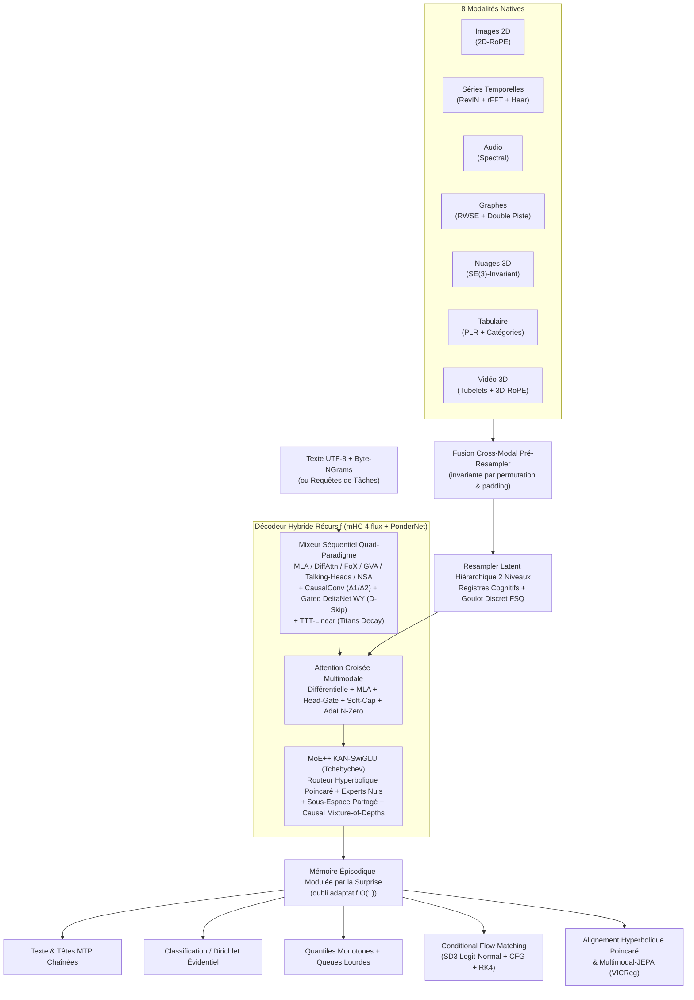

# BLUE

> **Architecture neuronale hybride multimodale PyTorch** réunissant **8 modalités natives**, un **décodeur quad-paradigme** (Attention + Convolution causale + Gated DeltaNet SSM + Test-Time Training), un **mélange d'experts KAN-SwiGLU hyperbolique**, un **raisonnement latent récursif PonderNet** et une **tête générative continue par Flow Matching**.

[](pyproject.toml)
[](https://pytorch.org/)
[-0A7EA4)](#modalités-et-tâches)
[](#tailles-et-configurations)
[](tests/)

> [!NOTE]
> **Portée et honnêteté expérimentale** — La complexité n'a pas de maximum absolu : on peut toujours empiler davantage de couches et d'experts. **BLUE** fournit une architecture modulaire, mathématiquement vérifiée et réellement entraînable de **739 506 à 1 695 180 105 990 paramètres**, avec un entraînement local démontré sur le preset `workstation` (**549 485 298 paramètres**). Les configurations géantes (`large`, `ultra`, `hyper`, `titan`) sont construites et comptées sur `torch.device("meta")` sans allocation des poids ; elles n'ont pas été préentraînées ici. Les checkpoints locaux sous `runs/` (exclus de Git en raison de leur taille) apprennent sur des signaux synthétiques appariés et démontrent l'apprentissage conjoint — ce ne sont pas des assistants préentraînés généralistes.

---

## Sommaire

- [Modalités et tâches](#modalités-et-tâches)
- [Architecture](#architecture)
- [Tailles et configurations](#tailles-et-configurations)
- [Démarrage rapide](#démarrage-rapide)
- [Entraînement, optimisation et adaptation](#entraînement-optimisation-et-adaptation)
- [Inférence, décodage avancé et quantification](#inférence-décodage-avancé-et-quantification)
- [Recherche cross-modale et hygiène des données](#recherche-cross-modale-et-hygiène-des-données)
- [API Python](#api-python)
- [Structure du dépôt et rapports techniques](#structure-du-dépôt-et-rapports-techniques)
- [Références](#références)

---

## Modalités et tâches

BLUE encode **8 modalités natives** pouvant être fournies seules, par paires ou conjointement (**$2^8 - 1 = 255$ combinaisons multimodales** et **$\binom{8}{2} = 28$ paires contrastives**) :

| # | Modalité | Encodeur dédié | Caractéristiques principales |
| :---: | :--- | :--- | :--- |
| 1 | **Texte UTF-8** | [`ByteTokenizer`](blue/tokenizer.py) + [`ByteNGramEmbedding`](blue/ngram.py) | Couverture Unicode totale sans BPE externe + embeddings causaux 2/3/4-grammes par hachage polynomial |
| 2 | **Vision (2D)** | [`VisionEncoder`](blue/modules.py) | Stem convolutif multi-échelle (3×3 / 5×5) + patches + **RoPE axial 2D** |
| 3 | **Séries temporelles** | [`TemporalEncoder`](blue/modules.py) + [`spectral.py`](blue/spectral.py) + [`wavelet.py`](blue/wavelet.py) | RevIN réversible tolérant `NaN`, statistiques relatives, mélange spectral **rFFT** + **ondelettes de Haar 1D** à porte apprise |
| 4 | **Audio** | [`AudioEncoder`](blue/audio.py) | Découpage temporel multi-canal + mélange spectral + encodeur Transformer |
| 5 | **Graphes attribués** | [`GraphEncoder`](blue/graph.py) | Encodage structurel par marches aléatoires (**RWSE**) + Graph Transformer double piste nœuds/arêtes |
| 6 | **Nuages de points 3D** | [`PointCloudEncoder`](blue/pointcloud.py) | Représentation géométrique **SE(3)-invariante** (invariante aux translations et rotations 3D) |
| 7 | **Données tabulaires** | [`TabularEncoder`](blue/tabular.py) | Encodage numérique périodique **PLR** + embeddings catégoriels + gestion native des valeurs manquantes (`NaN`/`-1`) |
| 8 | **Vidéo (3D)** | [`VideoEncoder`](blue/video.py) | Tubelets spatio-temporels `Conv3d` + **RoPE axial 3D** (temps, hauteur, largeur) |

Toutes les modalités alimentent un tronc commun qui produit simultanément **5 types de sorties** :
1. **Modélisation causale de texte & Multi-Token Prediction (MTP)** : prédiction du prochain octet + têtes auxiliaires futures chaînées (`chained_future_heads`) avec auto-distillation KL (`mtp_kl_weight`) et décroissance géométrique par horizon (`mtp_decay`).
2. **Classification & Incertitude Épistémique** : classification standard ou **évidentielle de Dirichlet** (`evidential_classification`, `Blue.dirichlet_uncertainty`) séparant croyance et incertitude.
3. **Prévision probabiliste de séries temporelles** : quantiles ordonnés garantis sans croisement, connexion directe depuis la dernière observation, exposants de queues lourdes appris (`forecast_tail_power`) et pénalité de courbure multi-pas (`forecast_smoothness_weight`).
4. **Génération continue par Conditional Flow Matching** : champ de vecteurs **AdaLN-Zero**, horaire temporel **Logit-Normal (SD3)**, **Classifier-Free Guidance** (`flow_cfg_dropout`) et solveurs ODE **Euler / Midpoint / Heun / RK4** sur grille linéaire ou cosinus.
5. **Représentations latentes partagées** : alignement contrastif **euclidien ou hyperbolique (boule de Poincaré)** à marge géodésique + prédicteur auto-supervisé **Multimodal-JEPA** avec régularisation **VICReg** (variance + décorrélation de covariance exacte en $O(B^2 D)$).

---

## Architecture



### Briques clés du décodeur et de la fusion

<details>
<summary><b>1. Attention avancée & encodages positionnels</b></summary>

- **GQA & Multi-Head Latent Attention (MLA)** (`kv_lora_rank`) : compression de rang bas du cache KV (jusqu'à **3,5× de compression** sur `titan`) avec découplage RoPE/NoPE.
- **Differential Attention** (`differential_attention`) : soustraction de deux cartes d'attention pondérées pour annuler le bruit de fond.
- **Attention Sinks permanents** (`attention_sinks`) : ancres apprises stables sur les séquences longues et fenêtres glissantes.
- **Value & QK Residual Learning (ResFormer)** (`value_residual`, `qk_residual`) : connexions résiduelles depuis la couche 0.
- **Forgetting Gate Attention (FoX)** (`forgetting_attention`), **Gated Value Attention (GVA)** (`gated_value_attention`), **Porte de confiance par tête** (`head_confidence_gate`) et **Talking-Heads** (`talking_heads`).
- **Native Sparse Attention (NSA)** (`nsa_block_size`, `nsa_top_k`) : sélection de blocs compressés Top-K en parallèle de l'attention dense.
- **Stabilité & extrapolation de contexte** : QK-Norm avec température logarithmique apprise par tête (`qk_norm_temperature`), échelle dynamique par position (`dynamic_attn_scale`), plafonnement lisse Gemma-2 (`attn_logit_softcap`, `logit_softcap`) et RoPE extensible **Linear / NTK / YaRN** (`rope_scaling_type`).

</details>

<details>
<summary><b>2. Mixeur séquentiel quad-paradigme (état O(1) en génération)</b></summary>

Chaque bloc combine jusqu'à **4 mécanismes séquentiels** arbitrés par un **routeur dynamique par token** (`dynamic_mixer_router`) :
1. **Attention causale locale / globale** (fenêtre glissante + contexte global tous les `global_every` blocs).
2. **Convolution causale à porte** (`GatedCausalConv`) enrichie d'opérateurs différentiels discrets du 1er et 2nd ordre $\Delta_1 / \Delta_2$ (`conv_diff_branch`).
3. **Gated DeltaNet SSM** ([`blue/ssm.py`](blue/ssm.py)) : mémoire associative matricielle accélérée par **scan parallèle par blocs WY exact** (`ssm_chunk_size`, **4,4× sur CPU**) avec connexion directe **D-Matrix** (`ssm_d_skip`) et entrelacement configurable (`ssm_every`).
4. **Test-Time Training `TTTLinear`** ([`blue/ttt.py`](blue/ttt.py)) : mini-réseau interne adapté en ligne par descente de gradient analytique à chaque token, avec **décroissance élastique style Titans** vers le prior méta $(W_0, b_0)$ (`ttt_weight_decay`).

</details>

<details>
<summary><b>3. Fusion multimodale, MoE++ hyperbolique et dynamique profonde</b></summary>

- **Resampler multimodal** : interaction cross-token pré-resampler (`cross_modal_fusion_layers`), compression hiérarchique à 2 niveaux (`hierarchical_resampler`), **registres cognitifs** (`register_latents`), goulot discret sans codebook **Finite Scalar Quantization (FSQ)** (`latent_fsq_levels`), et régularisation de diversité orthogonale (`latent_diversity_weight`).
- **Attention croisée enrichie** : différentielle (`cross_differential_attention`), latente MLA (`cross_kv_lora_rank`), température QK par tête (`cross_qk_temperature`), porte de confiance + Talking-Heads (`cross_head_gating`), soft-capping (`cross_logit_softcap`) et modulation contextuelle **AdaLN-Zero** (`multimodal_adaln`).
- **MoE++ KAN-SwiGLU** : experts SwiGLU augmentés de polynômes de **Tchebychev (KAN)** par canal (`kan_degree`), **sous-espace latent partagé** (`moe_shared_latent_dim`), **routeur hyperbolique sur la boule de Poincaré** (`moe_router_geometry="hyperbolic"`), **experts nuls zéro-FLOP** (`moe_null_experts`), **Causal Mixture-of-Depths** (`depth_routing_capacity`), facteur d'échelle routé appris style DeepSeek-V3 (`moe_learnable_scaling`), porte résiduelle pré-attention (`moe_input_residual_gate`), équilibrage sans perte auxiliaire (`router_bias_update_rate`) et régularisations d'entropie / orthogonalité des prototypes.
- **Dynamique profonde & mémoire** : **Manifold-Constrained Hyper-Connections (mHC)** sur le polytope de Birkhoff via Sinkhorn-Knopp logarithmique (`residual_streams > 1`), **LayerScale** (`layer_scale_init`), **Dynamic Tanh (DyT)** (`dynamic_tanh_norm`) ou **RMSNorm stable**, **raisonnement latent récursif PonderNet** à calcul dynamique au moment du test (`latent_reasoning_steps`, `latent_reasoning_adaptive`), skip embedding-vers-sortie (`embedding_output_skip`), et **banc de mémoire épisodique modulé par la surprise** avec oubli adaptatif (`memory_slots`, `memory_decay`).

</details>

> **Garanties mathématiques vérifiées par [`blue verify`](blue/verifier.py)** : causalité stricte (modifier les tokens futurs ne change jamais les logits passés), équivalence exacte entre passe complète et génération incrémentale cachée (KV + Conv + SSM + TTT + Mémoire + NGram), invariance exacte au padding, invariance SE(3) des nuages 3D, non-croisement des quantiles et intégrité des gradients.

---

## Tailles et configurations

Les comptes dédupliquent l'embedding texte et la tête de sortie (poids partagés). Chaque configuration peut être inspectée, profilée et documentée **sans allouer les poids** :

| Preset | Paramètres totaux | Couches décodeur (effectives) | Experts routés / top-k | Poids BF16 | Usage typique |
| :--- | ---: | :---: | :---: | ---: | :--- |
| `tiny` | 739 506 | 3 | 4 / 2 | 0,001 Gio | Tests rapides & prototypage CPU |
| `small` | 55 607 282 | 8 | 8 / 2 | 0,104 Gio | Expérimentation locale légère |
| `workstation` | 549 485 298 | 12 | 16 / 2 | 1,023 Gio | Modèle entraîné localement |
| `base` | 1 534 337 266 | 16 | 16 / 2 | 2,858 Gio | Configuration standard multi-GPU |
| `hyper` | **1 847 633 649** | 16 (32) | 16 / 2 | 3,441 Gio | **Full-Hybrid 8 modalités** (toutes briques actives) |
| `large` | 39 285 370 354 | 32 | 32 / 2 | 73,175 Gio | Grande échelle |
| `ultra` | 588 945 015 026 | 64 | 64 / 4 | 1 096,996 Gio | Cluster distribué |
| `titan` | **1 695 180 105 990** | 80 (160) | 64 / 4 | 3 157,519 Gio | **Full-Hybrid 8 modalités à l'échelle du trillion** |

Les fichiers JSON personnalisables se trouvent dans [`configs/`](configs/). Les presets `hyper` et `titan` activent l'ensemble de la pile architecturale (8 modalités, mHC 4 flux, quad-paradigme, KAN-MoE++ hyperbolique, PonderNet, Flow Matching SD3, JEPA VICReg, mémoire épisodique, alignement hyperbolique).

---

## Démarrage rapide

Prérequis : **Python 3.11+** et PyTorch (CPU ou CUDA).

```bash
# 1. Créer l'environnement virtuel et installer le paquet
python3 -m venv .venv
.venv/bin/python -m pip install torch --index-url https://download.pytorch.org/whl/cpu
.venv/bin/python -m pip install -e .

# 2. Exécuter une démonstration multimodale complète
.venv/bin/python -m blue demo

# 3. Inspecter toutes les architectures sans allouer les poids
.venv/bin/python -m blue inspect --all

# 4. Profiler empreinte KV/SSM/TTT/Mémoire & latence
.venv/bin/python -m blue profile --preset hyper --seq-len 2048

# 5. Générer la fiche technique Markdown + diagramme Mermaid dynamique
.venv/bin/python -m blue card --preset titan --output TITAN_CARD.md

# 6. Auditer causalité, cache, invariances SE(3)/padding et gradients
.venv/bin/python -m blue verify --preset tiny

# 7. Lancer l'ensemble des 129 suites de tests
.venv/bin/python -m unittest discover -s tests -v
```

> Sur GPU, installez une distribution PyTorch CUDA et ajoutez `--device cuda --amp bf16`. Le chemin GPU est fourni mais n'a pas été exécuté sur cette machine CPU.

---

## Entraînement, optimisation et adaptation

Le trainer ([`blue/training.py`](blue/training.py)) supporte :
- **Optimiseurs** : `AdamW` ou optimiseur hybride **`MuonAdamW`** (`--optimizer muon`, orthogonalisation Newton-Schulz sur les poids matriciels 2D + AdamW sur embeddings/normes/scalaires).
- **Plannings LR** : `cosine` ou **Warmup-Stable-Decay (`--lr-schedule wsd`)**.
- **Stabilité & efficacité** : EMA des poids (`--ema-decay`), AMP BF16/FP16, écrêtage de gradient avec repli FP64, recalcul sélectif d'activations (`checkpoint_every`), pondération adaptative par incertitude (`adaptive_loss_weighting`), lissage des étiquettes (`label_smoothing`) et Z-loss PaLM (`lm_z_loss_weight`).
- **Adaptation légère native** : **DoRA / LoRA** directement en CLI (`--dora-rank`) avec fusion algébrique exacte à l'export.
- **Modalités hétérogènes & DDP** : `--mixed-modalities`, `--loss-normalization observed`, `--modality-policy balanced`, alignement global distribué multi-rangs et **reprise exacte bit-à-bit** (`--resume`, y compris en DDP).

```bash
# Entraînement rapide CPU avec optimiseur Muon, planning WSD et EMA
.venv/bin/python -m blue train --preset tiny --steps 100 \
  --optimizer muon --lr-schedule wsd --ema-decay 0.995 --output runs/tiny-muon

# Générer un jeu JSONL multimodal et entraîner avec validation & arrêt anticipé
.venv/bin/python tools/make_dataset.py --preset tiny --output runs/data
.venv/bin/python -m blue train --preset tiny --steps 100 \
  --data runs/data/train.jsonl --val-data runs/data/validation.jsonl \
  --eval-every 10 --monitor observed_loss --patience 5 --output runs/custom

# Affinage DoRA sur un checkpoint existant
.venv/bin/python -m blue train --init-from runs/custom/best.pt \
  --data runs/data/train.jsonl --dora-rank 8 --steps 50 --output runs/dora

# Entraînement distribué DDP sur 2 processus (reprise exacte vérifiée par les tests)
.venv/bin/torchrun --standalone --nproc-per-node=2 -m blue --threads 1 train \
  --preset tiny --steps 10 --batch-size 2 --accumulation 2 --output runs/ddp
```

---

## Inférence, décodage avancé et quantification

### Stratégies de génération (`blue generate` / `Blue.generate`)

| Catégorie | Options disponibles |
| :--- | :--- |
| **Décodage accéléré & recherche** | Glouton (`--temperature 0`), **Beam Search** exact avec réordonnancement $O(1)$ du cache (`--beam-width`, `--length-penalty`), **Auto-Spéculatif exact** greedy & stochastique Leviathan (`--speculative`), **Jacobi parallèle** par point fixe (`--jacobi`, `--jacobi-window`) |
| **Guidage & calcul dynamique** | **Guidage contrastif multimodal CFG** (`--context-guidance-scale`), profondeur récursive dynamique à l'inférence (`--reasoning-steps`) |
| **Échantillonneurs adaptatifs** | `top-k`, `top-p`, **Min-P** (`--min-p`), **Locally Typical** (`--typical-p`), **$\eta$-Sampling** (`--eta-cutoff`), **Tail-Free Sampling** (`--tfs-z`), **Top-A** (`--top-a`), **Température dynamique par entropie EDT** (`--edt-theta`, `--edt-n`), **Mirostat v2** (`--mirostat-tau`, `--mirostat-eta`) |
| **Contrôle des répétitions** | Pénalités CTRL (`--repetition-penalty`), présence (`--presence-penalty`), fréquence (`--frequency-penalty`) et blocage exact de N-grammes (`--no-repeat-ngram-size`) |

```bash
# Génération avec décodage auto-spéculatif, Min-P et blocage de trigrammes
.venv/bin/python -m blue generate --checkpoint runs/custom/best.pt \
  --prompt "Signal de classe " --max-new-tokens 64 \
  --temperature 0.8 --min-p 0.05 --no-repeat-ngram-size 3 --speculative

# Export d'inférence : sélection EMA, fusion algébrique DoRA et quantification INT4 packée
.venv/bin/python -m blue export --checkpoint runs/dora/latest.pt \
  --use-ema --merge-dora --quantize-int4 --output runs/dora/model-int4.pt
```

> Les poids exportés utilisent le mappage mémoire (`mmap`) et l'initialisation sur `meta` pour limiter le pic RAM au chargement. La quantification **INT8 symétrique par canal** (`--quantize-int8`, > 3,5× de compression) et **INT4 packée par groupes** (`--quantize-int4`, 2 poids/octet, > 6× de compression) sont intégrées nativement.

---

## Recherche cross-modale et hygiène des données

Le format d'entrée JSONL accepte une combinaison libre de champs (`text`, `image` / `image_path`, `series`, `class_label`, `future`, plus les modalités étendues via l'API Python). Le lecteur indexé ([`blue/data.py`](blue/data.py)) charge les exemples à la demande et vérifie l'intégrité SHA-256 des fichiers et images externes.

```bash
# 1. Créer des découpages chronologiques sans fuite de fenêtres temporelles
.venv/bin/python -m blue prepare-series \
  --input data/series.jsonl --output-dir data/splits --config configs/tiny.json \
  --history 32 --stride 12 --gap 12 --train-end 1000 --validation-end 1300 --calibration-end 1600

# 2. Auditer l'absence de doublons ou chevauchements entre jeux
.venv/bin/python -m blue audit-splits \
  --split train=data/splits/train.jsonl --split test=data/splits/test.jsonl \
  --interval-fields series_id window_start window_end --fail-on-overlap

# 3. Extraire les embeddings et rechercher des voisins (euclidien ou hyperbolique Poincaré)
.venv/bin/python -m blue embed --checkpoint runs/custom/best.pt \
  --data runs/data/validation.jsonl --output runs/custom/embeddings.jsonl

.venv/bin/python -m blue search-embeddings \
  --queries runs/custom/embeddings.jsonl --query-modality text \
  --candidates runs/custom/embeddings.jsonl --candidate-modality series \
  --geometry hyperbolic --curvature 1.0 --top-k 5 --exclude-self \
  --output runs/custom/neighbors.jsonl
```

Pour l'évaluation (`evaluate`, `evaluate-retrieval`), la calibration conforme des intervalles de prévision (`calibrate`, `refine-forecast`) et les classifieurs temporels calibrés (`refine-series-classifier`, `calibrate-series-set`), consultez les rapports dédiés ci-dessous.

---

## API Python

```python
import torch
from blue import Blue, BlueConfig, ByteTokenizer

# Initialiser une configuration multimodale hybride
config = BlueConfig.preset("tiny")
config.flow_matching_dim = 8
config.evidential_classification = True
model = Blue(config)

tokenizer = ByteTokenizer()
tokens = torch.tensor([tokenizer.encode("Analyse du signal.")])

# Passe avant conjointe (texte + image + série + cible continue Flow Matching)
out = model(
    tokens,
    images=torch.rand(1, 3, 32, 32),
    series=torch.randn(1, 24, 3),
    labels=tokens,
    class_labels=torch.tensor([2]),
    forecast_targets=torch.randn(1, 12, 3),
    flow_targets=torch.randn(1, 8),
)
out.loss.backward()

# Inférence : incertitude épistémique, échantillonnage Flow Matching RK4 et génération
model.eval()
with torch.inference_mode():
    unc = Blue.dirichlet_uncertainty(out.classification_logits)
    flow_sample = model.sample_flow(
        input_ids=tokens, steps=10, solver="rk4", time_grid="cosine"
    )
    generated = model.generate(
        tokens, max_new_tokens=32, temperature=0.8, min_p=0.05, edt_theta=0.5
    )
    print(tokenizer.decode(generated[0]))
```

---

## Structure du dépôt et rapports techniques

### Modules principaux (`blue/`)

| Domaine | Fichiers |
| :--- | :--- |
| **Cœur & Configuration** | [`model.py`](blue/model.py), [`modules.py`](blue/modules.py), [`config.py`](blue/config.py), [`tokenizer.py`](blue/tokenizer.py), [`ngram.py`](blue/ngram.py) |
| **Séquentiel, Mémoire & Géométrie** | [`ssm.py`](blue/ssm.py), [`ttt.py`](blue/ttt.py), [`sparse_attention.py`](blue/sparse_attention.py), [`hyper_connections.py`](blue/hyper_connections.py), [`memory.py`](blue/memory.py), [`hyperbolic.py`](blue/hyperbolic.py), [`fsq.py`](blue/fsq.py) |
| **Encodeurs Multimodaux** | [`audio.py`](blue/audio.py), [`graph.py`](blue/graph.py), [`pointcloud.py`](blue/pointcloud.py), [`tabular.py`](blue/tabular.py), [`video.py`](blue/video.py), [`spectral.py`](blue/spectral.py), [`wavelet.py`](blue/wavelet.py) |
| **Génération Continue & Monde Latent** | [`flow_matching.py`](blue/flow_matching.py), [`jepa.py`](blue/jepa.py), [`losses.py`](blue/losses.py), [`distributed_alignment.py`](blue/distributed_alignment.py) |
| **Entraînement, Adaptation & Compression** | [`training.py`](blue/training.py), [`optimizer.py`](blue/optimizer.py), [`ema.py`](blue/ema.py), [`lora.py`](blue/lora.py), [`quantize.py`](blue/quantize.py), [`observed_objective.py`](blue/observed_objective.py) |
| **Diagnostics, Données & CLI** | [`cli.py`](blue/cli.py), [`cli_ops.py`](blue/cli_ops.py), [`data.py`](blue/data.py), [`profiler.py`](blue/profiler.py), [`card.py`](blue/card.py), [`verifier.py`](blue/verifier.py), [`evaluation.py`](blue/evaluation.py) |

### Rapports d'analyse et de validation inclus

- [Validation et audits](VALIDATION.md) · [Améliorations mémoire & vitesse](IMPROVEMENTS.md) · [Suivi de l'apprentissage](LEARNING.md)
- [Calibration conforme des prévisions](CALIBRATION.md) · [Correction des historiques courts](FORECAST_REFINEMENT.md) · [Robustesse temporelle](ROBUSTNESS.md)
- [Statistiques temporelles](TEMPORAL_STATISTICS.md) · [Classification temporelle standardisée](SERIES_CLASSIFICATION.md) · [Robustesse affine](AFFINE_ROBUSTNESS.md)
- [Précision numérique & RMSNorm stable](NUMERICAL_PRECISION.md) · [Routage Top-1 probabiliste](TOP1_ROUTING.md)
- Intégration continue : [CI GitHub Actions Python 3.11 & 3.14](.github/workflows/tests.yml) · Benchmarks : [`tools/benchmark_architectures.py`](tools/benchmark_architectures.py)

---

## Références

BLUE combine et adapte librement des concepts issus de la littérature récente (sans prétendre être une reproduction officielle de ces modèles) :

- **Attention & Contexte** : [GQA (Ainslie et al.)](https://arxiv.org/abs/2305.13245) · [RoFormer (Su et al.)](https://arxiv.org/abs/2104.09864) · [YaRN (Peng et al.)](https://arxiv.org/abs/2309.00071) · [DeepSeek-V2/V3 MLA & Loss-Free MoE](https://arxiv.org/abs/2412.19437) · [Differential Transformer (Ye et al.)](https://arxiv.org/abs/2410.05258) · [ResFormer](https://arxiv.org/abs/2410.17897) · [Forgetting Transformer (FoX)](https://arxiv.org/abs/2503.02130) · [Native Sparse Attention](https://arxiv.org/abs/2502.11089) · [Talking-Heads Attention](https://arxiv.org/abs/2003.02436)
- **Récurrence, SSM & Test-Time Training** : [Gated DeltaNet (Yang et al.)](https://arxiv.org/abs/2412.06464) · [Test-Time Training (Sun et al.)](https://arxiv.org/abs/2407.04620) · [Titans (Behrouz et al.)](https://arxiv.org/abs/2501.00663)
- **MoE, Hyper-Connections & Normalisation** : [Switch Transformers](https://arxiv.org/abs/2101.03961) · [ST-MoE](https://arxiv.org/abs/2202.08906) · [Mixture-of-Depths](https://arxiv.org/abs/2404.02258) · [KAN (Liu et al.)](https://arxiv.org/abs/2404.19756) · [Dynamic Tanh (DyT)](https://arxiv.org/abs/2503.10622) · [Perceiver IO](https://arxiv.org/abs/2107.14795) · [FSQ (Mentzer et al.)](https://arxiv.org/abs/2309.15505)
- **Génération, Monde Latent & Optimisation** : [Flow Matching / SD3 (Esser et al.)](https://arxiv.org/abs/2403.03206) · [VICReg (Bardes et al.)](https://arxiv.org/abs/2105.04906) · [PonderNet](https://arxiv.org/abs/2107.05407) · [DoRA (Liu et al.)](https://arxiv.org/abs/2402.09353) · [Speculative Decoding (Leviathan et al.)](https://arxiv.org/abs/2211.17192) · [Mirostat](https://arxiv.org/abs/2007.14966) · [Eta-Sampling (Hewitt et al.)](https://arxiv.org/abs/2210.15191)
