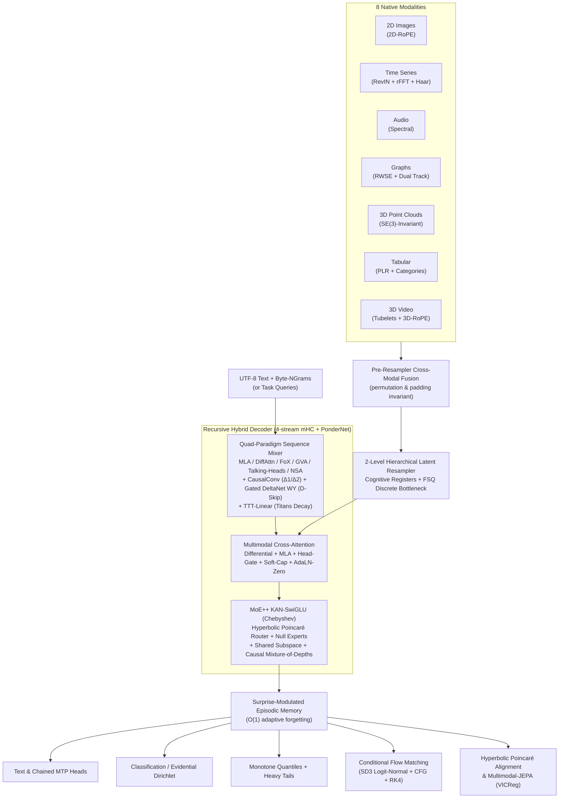

# BLUE

> **PyTorch multimodal hybrid neural architecture** uniting **8 native modalities**, a **quad-paradigm decoder** (Attention + Causal Convolution + Gated DeltaNet SSM + Test-Time Training), a **hyperbolic KAN-SwiGLU Mixture of Experts**, **PonderNet recursive latent reasoning**, and a **continuous Flow Matching generative head**.

[](pyproject.toml)
[](https://pytorch.org/)
[-0A7EA4)](#modalities-and-tasks)
[](#sizes-and-configurations)
[](tests/)

> [!NOTE]
> **Scope and experimental honesty** — Complexity has no absolute ceiling: you can always stack more layers and experts. **BLUE** provides a modular, mathematically verified, genuinely trainable architecture spanning **739,506 to 1,695,180,105,990 parameters**, with local training demonstrated on the `workstation` preset (**549,485,298 parameters**). Giant configurations (`large`, `ultra`, `hyper`, `titan`) are constructed and counted on `torch.device("meta")` without allocating weights; they have not been pretrained here. Local checkpoints under `runs/` (excluded from Git due to their size) train on paired synthetic signals and demonstrate joint learning — they are not general-purpose pretrained assistants.

---

## Contents

- [Modalities and tasks](#modalities-and-tasks)
- [Architecture](#architecture)
- [Sizes and configurations](#sizes-and-configurations)
- [Quick start](#quick-start)
- [Training, optimization and adaptation](#training-optimization-and-adaptation)
- [Inference, advanced decoding and quantization](#inference-advanced-decoding-and-quantization)
- [Cross-modal search and data hygiene](#cross-modal-search-and-data-hygiene)
- [Python API](#python-api)
- [Repository structure and technical reports](#repository-structure-and-technical-reports)
- [References](#references)

---

## Modalities and tasks

BLUE encodes **8 native modalities** that can be supplied individually, in pairs, or jointly (**$2^8 - 1 = 255$ multimodal combinations** and **$\binom{8}{2} = 28$ contrastive pairs**):

| # | Modality | Dedicated encoder | Key characteristics |
| :---: | :--- | :--- | :--- |
| 1 | **UTF-8 text** | [`ByteTokenizer`](blue/tokenizer.py) + [`ByteNGramEmbedding`](blue/ngram.py) | Full Unicode coverage with no external BPE + causal 2/3/4-gram embeddings via polynomial hashing |
| 2 | **Vision (2D)** | [`VisionEncoder`](blue/modules.py) | Multi-scale convolutional stem (3×3 / 5×5) + patches + **2D axial RoPE** |
| 3 | **Time series** | [`TemporalEncoder`](blue/modules.py) + [`spectral.py`](blue/spectral.py) + [`wavelet.py`](blue/wavelet.py) | `NaN`-tolerant reversible RevIN, relative statistics, **rFFT** spectral mixing + learned-gate **1D Haar wavelets** |
| 4 | **Audio** | [`AudioEncoder`](blue/audio.py) | Multi-channel temporal framing + spectral mixing + Transformer encoder |
| 5 | **Attributed graphs** | [`GraphEncoder`](blue/graph.py) | Random-walk structural encoding (**RWSE**) + dual-track node/edge Graph Transformer |
| 6 | **3D point clouds** | [`PointCloudEncoder`](blue/pointcloud.py) | **SE(3)-invariant** geometric representation (invariant to 3D translations and rotations) |
| 7 | **Tabular data** | [`TabularEncoder`](blue/tabular.py) | Periodic numerical encoding (**PLR**) + categorical embeddings + native missing-value handling (`NaN`/`-1`) |
| 8 | **Video (3D)** | [`VideoEncoder`](blue/video.py) | Spatio-temporal `Conv3d` tubelets + **3D axial RoPE** (time, height, width) |

All modalities feed a shared trunk that simultaneously produces **5 types of outputs**:
1. **Causal text modeling & Multi-Token Prediction (MTP)**: next-byte prediction + chained auxiliary future heads (`chained_future_heads`) with KL self-distillation (`mtp_kl_weight`) and geometric horizon decay (`mtp_decay`).
2. **Classification & Epistemic Uncertainty**: standard or **evidential Dirichlet classification** (`evidential_classification`, `Blue.dirichlet_uncertainty`) separating belief from uncertainty.
3. **Probabilistic time-series forecasting**: guaranteed non-crossing ordered quantiles, direct skip connection from the last observation, learned heavy-tail exponents (`forecast_tail_power`), and multi-step curvature penalty (`forecast_smoothness_weight`).
4. **Continuous generation via Conditional Flow Matching**: **AdaLN-Zero** vector field, **Logit-Normal (SD3)** time schedule, **Classifier-Free Guidance** (`flow_cfg_dropout`), and **Euler / Midpoint / Heun / RK4** ODE solvers on a linear or cosine grid.
5. **Shared latent representations**: **Euclidean or hyperbolic (Poincaré ball)** contrastive alignment with geodesic margin + self-supervised **Multimodal-JEPA** predictor with **VICReg** regularization (variance + exact $O(B^2 D)$ covariance decorrelation).

---

## Architecture



### Key decoder and fusion building blocks

<details>
<summary><b>1. Advanced attention & positional encodings</b></summary>

- **GQA & Multi-Head Latent Attention (MLA)** (`kv_lora_rank`): low-rank KV cache compression (up to **3.5× compression** on `titan`) with decoupled RoPE/NoPE.
- **Differential Attention** (`differential_attention`): subtraction of two weighted attention maps to cancel background noise.
- **Permanent Attention Sinks** (`attention_sinks`): stable learned anchors across long sequences and sliding windows.
- **Value & QK Residual Learning (ResFormer)** (`value_residual`, `qk_residual`): residual connections from layer 0.
- **Forgetting Gate Attention (FoX)** (`forgetting_attention`), **Gated Value Attention (GVA)** (`gated_value_attention`), **Per-head confidence gate** (`head_confidence_gate`), and **Talking-Heads** (`talking_heads`).
- **Native Sparse Attention (NSA)** (`nsa_block_size`, `nsa_top_k`): Top-K compressed block selection in parallel with dense attention.
- **Stability & context extrapolation**: QK-Norm with per-head learned logarithmic temperature (`qk_norm_temperature`), position-dependent dynamic scaling (`dynamic_attn_scale`), Gemma-2 smooth logit soft-capping (`attn_logit_softcap`, `logit_softcap`), and extensible **Linear / NTK / YaRN** RoPE (`rope_scaling_type`).

</details>

<details>
<summary><b>2. Quad-paradigm sequence mixer (O(1) state during generation)</b></summary>

Each block combines up to **4 sequential mechanisms** arbitrated by a **per-token dynamic router** (`dynamic_mixer_router`):
1. **Local / global causal attention** (sliding window + global context every `global_every` blocks).
2. **Gated causal convolution** (`GatedCausalConv`) augmented with 1st- and 2nd-order discrete differential operators $\Delta_1 / \Delta_2$ (`conv_diff_branch`).
3. **Gated DeltaNet SSM** ([`blue/ssm.py`](blue/ssm.py)): matrix associative memory accelerated by an **exact WY chunked parallel scan** (`ssm_chunk_size`, **4.4× on CPU**) with a direct **D-Matrix** skip (`ssm_d_skip`) and configurable interleaving (`ssm_every`).
4. **Test-Time Training `TTTLinear`** ([`blue/ttt.py`](blue/ttt.py)): internal mini-network adapted online via analytical gradient descent at every token, with **Titans-style elastic decay** toward the meta-prior $(W_0, b_0)$ (`ttt_weight_decay`).

</details>

<details>
<summary><b>3. Multimodal fusion, hyperbolic MoE++ and deep dynamics</b></summary>

- **Multimodal resampler**: pre-resampler cross-token interaction (`cross_modal_fusion_layers`), 2-level hierarchical compression (`hierarchical_resampler`), **cognitive registers** (`register_latents`), codebook-free discrete bottleneck via **Finite Scalar Quantization (FSQ)** (`latent_fsq_levels`), and orthogonal diversity regularization (`latent_diversity_weight`).
- **Enriched cross-attention**: differential (`cross_differential_attention`), latent MLA (`cross_kv_lora_rank`), per-head QK temperature (`cross_qk_temperature`), confidence gate + Talking-Heads (`cross_head_gating`), soft-capping (`cross_logit_softcap`), and **AdaLN-Zero** contextual modulation (`multimodal_adaln`).
- **MoE++ KAN-SwiGLU**: SwiGLU experts augmented with per-channel **Chebyshev (KAN)** polynomials (`kan_degree`), **shared latent subspace** (`moe_shared_latent_dim`), **hyperbolic router on the Poincaré ball** (`moe_router_geometry="hyperbolic"`), **zero-FLOP null experts** (`moe_null_experts`), **Causal Mixture-of-Depths** (`depth_routing_capacity`), DeepSeek-V3-style learned routed scaling factor (`moe_learnable_scaling`), pre-attention residual gate (`moe_input_residual_gate`), auxiliary-loss-free load balancing (`router_bias_update_rate`), and prototype entropy / orthogonality regularizers.
- **Deep dynamics & memory**: **Manifold-Constrained Hyper-Connections (mHC)** on the Birkhoff polytope via log-domain Sinkhorn-Knopp (`residual_streams > 1`), **LayerScale** (`layer_scale_init`), **Dynamic Tanh (DyT)** (`dynamic_tanh_norm`) or **stable RMSNorm**, **PonderNet recursive latent reasoning** with dynamic test-time compute (`latent_reasoning_steps`, `latent_reasoning_adaptive`), embedding-to-output skip (`embedding_output_skip`), and a **surprise-modulated episodic memory bank** with adaptive forgetting (`memory_slots`, `memory_decay`).

</details>

> **Mathematical guarantees verified by [`blue verify`](blue/verifier.py)**: strict causality (modifying future tokens never changes past logits), exact equivalence between full forward pass and cached incremental generation (KV + Conv + SSM + TTT + Memory + NGram), exact padding invariance, SE(3) invariance for 3D point clouds, non-crossing quantiles, and gradient integrity.

---

## Sizes and configurations

Counts deduplicate the text embedding and output head (tied weights). Every configuration can be inspected, profiled, and documented **without allocating weights**:

| Preset | Total parameters | Decoder layers (effective) | Routed experts / top-k | BF16 weights | Typical use |
| :--- | ---: | :---: | :---: | ---: | :--- |
| `tiny` | 739,506 | 3 | 4 / 2 | 0.001 GiB | Fast tests & CPU prototyping |
| `small` | 55,607,282 | 8 | 8 / 2 | 0.104 GiB | Lightweight local experimentation |
| `workstation` | 549,485,298 | 12 | 16 / 2 | 1.023 GiB | Locally trained model |
| `base` | 1,534,337,266 | 16 | 16 / 2 | 2.858 GiB | Standard multi-GPU configuration |
| `hyper` | **1,847,633,649** | 16 (32) | 16 / 2 | 3.441 GiB | **Full-Hybrid 8 modalities** (all blocks enabled) |
| `large` | 39,285,370,354 | 32 | 32 / 2 | 73.175 GiB | Large scale |
| `ultra` | 588,945,015,026 | 64 | 64 / 4 | 1,096.996 GiB | Distributed cluster |
| `titan` | **1,695,180,105,990** | 80 (160) | 64 / 4 | 3,157.519 GiB | **Trillion-scale Full-Hybrid 8 modalities** |

Customizable JSON files live in [`configs/`](configs/). The `hyper` and `titan` presets enable the entire architectural stack (8 modalities, 4-stream mHC, quad-paradigm mixer, hyperbolic KAN-MoE++, PonderNet, SD3 Flow Matching, JEPA VICReg, episodic memory, hyperbolic alignment).

---

## Quick start

Prerequisites: **Python 3.11+** and PyTorch (CPU or CUDA).

```bash
# 1. Create the virtual environment and install the package
python3 -m venv .venv
.venv/bin/python -m pip install torch --index-url https://download.pytorch.org/whl/cpu
.venv/bin/python -m pip install -e .

# 2. Run a full multimodal demonstration
.venv/bin/python -m blue demo

# 3. Inspect all architectures without allocating weights
.venv/bin/python -m blue inspect --all

# 4. Profile KV/SSM/TTT/Memory footprint & latency
.venv/bin/python -m blue profile --preset hyper --seq-len 2048

# 5. Generate a Markdown model card + dynamic Mermaid diagram
.venv/bin/python -m blue card --preset titan --output TITAN_CARD.md

# 6. Audit causality, caching, SE(3)/padding invariances and gradients
.venv/bin/python -m blue verify --preset tiny

# 7. Run all 135 test suites in parallel (dev tools: pip install -e '.[dev]'), then lint
.venv/bin/python -m pytest -n auto tests      # serial alternative: python -m unittest discover -s tests
.venv/bin/ruff check blue tools tests
```

> Invalid options or inputs print `blue : erreur : <message>` and exit with status 2; set `BLUE_TRACEBACK=1` to see the full Python traceback.
>
> On GPU, install a CUDA PyTorch build and add `--device cuda` (optionally `--amp bf16`, or `--matmul-precision high` to use TF32 for FP32 matrix products on Ampere and newer GPUs). GPU kernels are not bit-reproducible by default; the global `--deterministic` flag makes GPU runs and resumes identical bit for bit (small preset: about 63 vs 60 ms per step). Training and decoding were benchmarked on an RTX 3060 Ti ([audit](AUDIT.md)); the test suite runs on CPU, plus CUDA smoke tests when a GPU is available.

---

## Training, optimization and adaptation

The trainer ([`blue/training.py`](blue/training.py)) supports:
- **Optimizers**: `AdamW` or hybrid **`MuonAdamW`** (`--optimizer muon`, Newton-Schulz orthogonalization on linear projection weights and LoRA factors + AdamW on embeddings, norms, gains, biases and other tensors).
- **LR schedules**: `cosine` or **Warmup-Stable-Decay (`--lr-schedule wsd`)**.
- **Stability & efficiency**: weight EMA (`--ema-decay`), BF16/FP16 AMP, gradient clipping with FP64 fallback, selective activation checkpointing (`checkpoint_every`), adaptive uncertainty loss weighting (`adaptive_loss_weighting`), label smoothing (`label_smoothing`), and PaLM Z-loss (`lm_z_loss_weight`).
- **Native lightweight adaptation**: **DoRA / LoRA** directly from the CLI (`--dora-rank`) with exact algebraic merge on export.
- **Heterogeneous modalities & DDP**: `--mixed-modalities`, `--loss-normalization observed`, `--modality-policy balanced`, multi-rank distributed global alignment, and **bit-exact resume** (`--resume`, or `--resume auto` to continue from `OUTPUT/latest.pt` when it exists, including under DDP).

```bash
# Fast CPU training with Muon optimizer, WSD schedule and EMA
.venv/bin/python -m blue train --preset tiny --steps 100 \
  --optimizer muon --lr-schedule wsd --ema-decay 0.995 --output runs/tiny-muon

# Generate a multimodal JSONL dataset and train with validation & early stopping
.venv/bin/python tools/make_dataset.py --preset tiny --output runs/data
.venv/bin/python -m blue train --preset tiny --steps 100 \
  --data runs/data/train.jsonl --val-data runs/data/validation.jsonl \
  --eval-every 10 --monitor observed_loss --patience 5 --output runs/custom

# DoRA fine-tuning from an existing checkpoint
.venv/bin/python -m blue train --init-from runs/custom/best.pt \
  --data runs/data/train.jsonl --dora-rank 8 --steps 50 --output runs/dora

# Distributed DDP training on 2 processes (exact resume verified by tests)
.venv/bin/torchrun --standalone --nproc-per-node=2 -m blue --threads 1 train \
  --preset tiny --steps 10 --batch-size 2 --accumulation 2 --output runs/ddp
```

---

## Inference, advanced decoding and quantization

### Generation strategies (`blue generate` / `Blue.generate`)

| Category | Available options |
| :--- | :--- |
| **Accelerated decoding & search** | Greedy (`--temperature 0`), exact **Beam Search** with $O(1)$ cache reordering (`--beam-width`, `--length-penalty`), exact **Self-Speculative** greedy & Leviathan stochastic decoding (`--speculative`), parallel fixed-point **Jacobi** decoding (`--jacobi`, `--jacobi-window`) |
| **Guidance & dynamic compute** | **Multimodal contrastive CFG** (`--context-guidance-scale`), dynamic recursive reasoning depth at inference (`--reasoning-steps`) |
| **Adaptive samplers** | `top-k`, `top-p`, **Min-P** (`--min-p`), **Locally Typical** (`--typical-p`), **$\eta$-Sampling** (`--eta-cutoff`), **Tail-Free Sampling** (`--tfs-z`), **Top-A** (`--top-a`), **Entropy-Based Dynamic Temperature (EDT)** (`--edt-theta`, `--edt-n`), **Mirostat v2** (`--mirostat-tau`, `--mirostat-eta`) |
| **Repetition control** | CTRL repetition penalty (`--repetition-penalty`), presence (`--presence-penalty`), frequency (`--frequency-penalty`), and exact N-gram blocking (`--no-repeat-ngram-size`) |
| **Reproducibility** | `--seed` fixes the sampling stream of `blue generate` |

Beam search also runs on batches (one search per row, rows padded with `eos_id`). Contrastive guidance and Mirostat are only implemented by the standard sampling loop: combining them with beam, speculative or Jacobi decoding raises an error instead of being silently ignored.

```bash
# Generation with self-speculative decoding, Min-P and trigram blocking
.venv/bin/python -m blue generate --checkpoint runs/custom/best.pt \
  --prompt "Class signal " --max-new-tokens 64 \
  --temperature 0.8 --min-p 0.05 --no-repeat-ngram-size 3 --speculative

# Batched predictions: consecutive rows sharing the same modalities run together
.venv/bin/python -m blue predict --checkpoint runs/custom/best.pt \
  --data data/test.jsonl --batch-size 32 --output runs/custom/predictions.jsonl

# Inference export: EMA selection, algebraic DoRA merge and packed INT4 quantization
.venv/bin/python -m blue export --checkpoint runs/dora/latest.pt \
  --use-ema --merge-dora --quantize-int4 --output runs/dora/model-int4.pt
```

> Exported weights use memory mapping (`mmap`) and `meta` initialization to reduce peak RAM on load. **Per-channel symmetric INT8** quantization (`--quantize-int8`, > 3.5× compression) and **group-wise packed INT4** quantization (`--quantize-int4`, 2 weights/byte, > 6× compression) are built in. On CPU (small preset), INT8 also decodes faster than FP32 (7.7 vs 9.1 ms/token) while INT4 trades speed for size (13.1 ms/token, unpacking cost).

---

## Cross-modal search and data hygiene

The JSONL input format accepts any combination of fields (`text`, `image` / `image_path`, `series`, `audio`, `graph_nodes` / `graph_edges`, `points` / `point_features`, `tabular_num` / `tabular_cat`, `video`, `class_label`, `future`; the extended modalities must be enabled in the configuration). The indexed reader ([`blue/data.py`](blue/data.py)) loads examples on demand, checks every array against the configured shapes (errors name the file and line) and verifies SHA-256 integrity for external files and images.

```bash
# 1. Create chronological splits without temporal window leakage
.venv/bin/python -m blue prepare-series \
  --input data/series.jsonl --output-dir data/splits --config configs/tiny.json \
  --history 32 --stride 12 --gap 12 --train-end 1000 --validation-end 1300 --calibration-end 1600

# 2. Audit splits for duplicates or interval overlaps
.venv/bin/python -m blue audit-splits \
  --split train=data/splits/train.jsonl --split test=data/splits/test.jsonl \
  --interval-fields series_id window_start window_end --fail-on-overlap

# 3. Extract embeddings and search nearest neighbors (Euclidean or hyperbolic Poincaré)
.venv/bin/python -m blue embed --checkpoint runs/custom/best.pt \
  --data runs/data/validation.jsonl --output runs/custom/embeddings.jsonl

.venv/bin/python -m blue search-embeddings \
  --queries runs/custom/embeddings.jsonl --query-modality text \
  --candidates runs/custom/embeddings.jsonl --candidate-modality series \
  --geometry hyperbolic --curvature 1.0 --top-k 5 --exclude-self \
  --output runs/custom/neighbors.jsonl
```

For evaluation (`evaluate`, `evaluate-retrieval`), conformal calibration of forecast intervals (`calibrate`, `refine-forecast`), and calibrated temporal classifiers (`refine-series-classifier`, `calibrate-series-set`), see the dedicated reports below.

---

## Python API

```python
import torch
from blue import Blue, BlueConfig, ByteTokenizer

# Initialize a hybrid multimodal configuration
config = BlueConfig.preset("tiny")
config.flow_matching_dim = 8
config.evidential_classification = True
model = Blue(config)

tokenizer = ByteTokenizer()
tokens = torch.tensor([tokenizer.encode("Signal analysis.")])

# Joint forward pass (text + image + series + continuous Flow Matching target)
out = model(
    tokens,
    images=torch.rand(1, 3, 32, 32),
    series=torch.randn(1, 24, 3),
    labels=tokens,
    class_labels=torch.tensor([2]),
    forecast_targets=torch.randn(1, 12, 3),
    flow_targets=torch.randn(1, 8),
)
out.loss.backward()

# Inference: epistemic uncertainty, RK4 Flow Matching sampling and generation
model.eval()
with torch.inference_mode():
    unc = Blue.dirichlet_uncertainty(out.classification_logits)
    flow_sample = model.sample_flow(
        input_ids=tokens, steps=10, solver="rk4", time_grid="cosine"
    )
    generated = model.generate(
        tokens, max_new_tokens=32, temperature=0.8, min_p=0.05, edt_theta=0.5
    )
    print(tokenizer.decode(generated[0]))
```

---

## Repository structure and technical reports

### Core modules (`blue/`)

| Area | Files |
| :--- | :--- |
| **Core & Configuration** | [`model.py`](blue/model.py), [`modules.py`](blue/modules.py), [`config.py`](blue/config.py), [`tokenizer.py`](blue/tokenizer.py), [`ngram.py`](blue/ngram.py) |
| **Sequence, Memory & Geometry** | [`ssm.py`](blue/ssm.py), [`ttt.py`](blue/ttt.py), [`sparse_attention.py`](blue/sparse_attention.py), [`hyper_connections.py`](blue/hyper_connections.py), [`memory.py`](blue/memory.py), [`hyperbolic.py`](blue/hyperbolic.py), [`fsq.py`](blue/fsq.py) |
| **Multimodal Encoders** | [`audio.py`](blue/audio.py), [`graph.py`](blue/graph.py), [`pointcloud.py`](blue/pointcloud.py), [`tabular.py`](blue/tabular.py), [`video.py`](blue/video.py), [`spectral.py`](blue/spectral.py), [`wavelet.py`](blue/wavelet.py), [`ragged.py`](blue/ragged.py) (batched variable-length rows) |
| **Continuous Generation & Latent World** | [`flow_matching.py`](blue/flow_matching.py), [`jepa.py`](blue/jepa.py), [`losses.py`](blue/losses.py), [`distributed_alignment.py`](blue/distributed_alignment.py) |
| **Training, Adaptation & Compression** | [`training.py`](blue/training.py), [`optimizer.py`](blue/optimizer.py), [`ema.py`](blue/ema.py), [`lora.py`](blue/lora.py), [`quantize.py`](blue/quantize.py), [`observed_objective.py`](blue/observed_objective.py) |
| **Diagnostics, Data & CLI** | [`cli.py`](blue/cli.py), [`cli_ops.py`](blue/cli_ops.py), [`data.py`](blue/data.py), [`profiler.py`](blue/profiler.py), [`card.py`](blue/card.py), [`verifier.py`](blue/verifier.py), [`evaluation.py`](blue/evaluation.py) |

### Included analysis and validation reports

- [Validation and audits](VALIDATION.md) · [Memory & speed improvements](IMPROVEMENTS.md) · [Learning progress](LEARNING.md)
- [Conformal forecast calibration](CALIBRATION.md) · [Short-history refinement](FORECAST_REFINEMENT.md) · [Temporal robustness](ROBUSTNESS.md)
- [Temporal statistics](TEMPORAL_STATISTICS.md) · [Standardized series classification](SERIES_CLASSIFICATION.md) · [Affine robustness](AFFINE_ROBUSTNESS.md)
- [Numerical precision & stable RMSNorm](NUMERICAL_PRECISION.md) · [Probabilistic Top-1 routing](TOP1_ROUTING.md)
- [Contributing: tests, golden outputs, benchmarks](CONTRIBUTING.md) · [Code audit: fixes and performance](AUDIT.md) · Hot-path benchmark: [`tools/benchmark_hotpaths.py`](tools/benchmark_hotpaths.py)
- Continuous integration: [GitHub Actions CI Python 3.11 & 3.14](.github/workflows/tests.yml) · Benchmarks: [`tools/benchmark_architectures.py`](tools/benchmark_architectures.py)

---

## References

BLUE freely combines and adapts ideas from recent literature (without claiming to be an official reproduction of these models):

- **Attention & Context**: [GQA (Ainslie et al.)](https://arxiv.org/abs/2305.13245) · [RoFormer (Su et al.)](https://arxiv.org/abs/2104.09864) · [YaRN (Peng et al.)](https://arxiv.org/abs/2309.00071) · [DeepSeek-V2/V3 MLA & Loss-Free MoE](https://arxiv.org/abs/2412.19437) · [Differential Transformer (Ye et al.)](https://arxiv.org/abs/2410.05258) · [ResFormer](https://arxiv.org/abs/2410.17897) · [Forgetting Transformer (FoX)](https://arxiv.org/abs/2503.02130) · [Native Sparse Attention](https://arxiv.org/abs/2502.11089) · [Talking-Heads Attention](https://arxiv.org/abs/2003.02436)
- **Recurrence, SSM & Test-Time Training**: [Gated DeltaNet (Yang et al.)](https://arxiv.org/abs/2412.06464) · [Test-Time Training (Sun et al.)](https://arxiv.org/abs/2407.04620) · [Titans (Behrouz et al.)](https://arxiv.org/abs/2501.00663)
- **MoE, Hyper-Connections & Normalization**: [Switch Transformers](https://arxiv.org/abs/2101.03961) · [ST-MoE](https://arxiv.org/abs/2202.08906) · [Mixture-of-Depths](https://arxiv.org/abs/2404.02258) · [KAN (Liu et al.)](https://arxiv.org/abs/2404.19756) · [Dynamic Tanh (DyT)](https://arxiv.org/abs/2503.10622) · [Perceiver IO](https://arxiv.org/abs/2107.14795) · [FSQ (Mentzer et al.)](https://arxiv.org/abs/2309.15505)
- **Generation, Latent World & Optimization**: [Flow Matching / SD3 (Esser et al.)](https://arxiv.org/abs/2403.03206) · [VICReg (Bardes et al.)](https://arxiv.org/abs/2105.04906) · [PonderNet](https://arxiv.org/abs/2107.05407) · [DoRA (Liu et al.)](https://arxiv.org/abs/2402.09353) · [Speculative Decoding (Leviathan et al.)](https://arxiv.org/abs/2211.17192) · [Mirostat](https://arxiv.org/abs/2007.14966) · [Eta-Sampling (Hewitt et al.)](https://arxiv.org/abs/2210.15191)
